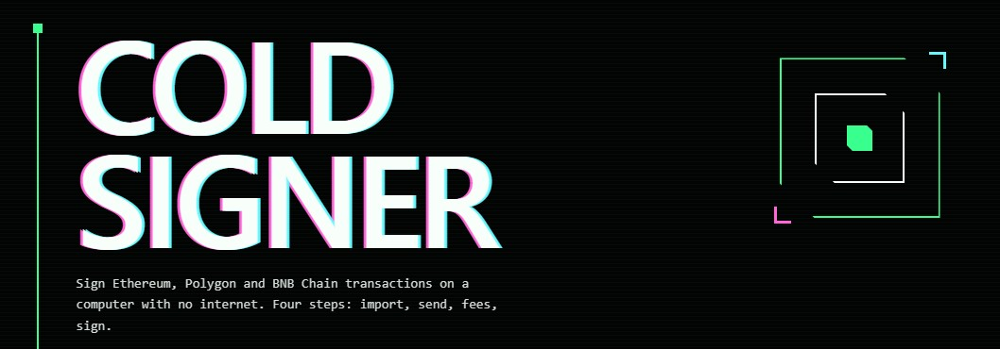

# Cold Signer + Tx Broadcaster



Two small HTML files to send **Ethereum, Polygon and BNB Chain** transactions with your private key on a computer that is **never connected to the internet**.

No install. No server. No account. Each tool is a **single HTML file** that you open in a browser.

> **Why this exists:** phone wallets and browser wallets keep getting hacked (malware, fake apps, malicious updates, and now AI-made phishing and attacks). A key that lives on a device that is online can be stolen. A key that lives on a device that is **never online** is much harder to reach.

---

## The idea in 3 lines

1. **Offline computer** → `cold-signer.html` creates and **signs** the transaction.
2. You move the signed text to an online device (by **QR code**, or by typing/copying it).
3. **Online device** → `tx-broadcaster.html` **sends** the signed transaction to the network.

Your private key **never touches an online device**.

```
 OFFLINE PC (never online)                ONLINE PHONE / PC
 ┌───────────────────────┐   QR code    ┌───────────────────────┐
 │   cold-signer.html    │ ───────────► │  tx-broadcaster.html  │ ───► blockchain
 │  (has your key)       │  signed hex  │  (no key, ever)       │
 └───────────────────────┘              └───────────────────────┘
```

---

## The files

### `cold-signer.html`  →  OFFLINE computer ONLY

This is the wallet. It runs fully inside the browser and makes **no network requests** (it also blocks them with a strict Content-Security-Policy).

It works in 4 steps:

| Step | What you do |
|------|-------------|
| 1. Import | Load your key: **seed phrase** (12–24 words), **New wallet** (generate one), **JSON keystore file**, or passphrase (not recommended, see warning below). Your address is shown so you can check it is the right wallet. |
| 2. Send | Choose network (Ethereum / Polygon / BNB Chain), asset (native coin, USDT or USDC), recipient, amount and nonce. |
| 3. Fees | Choose Low / Normal / Fast or enter your own gas values. |
| 4. Sign | Check every line, then sign. You get the **raw signed hex** and a **QR code**. |

Good to know:
- Supports **ETH / POL / BNB**, plus **USDT and USDC** on each of those networks.
- **Nothing is saved.** Close or reload the page and everything is erased.
- It shows **Offline** or **Online: disconnect first** at the top, so you can see if the computer is connected.
- The **nonce** (your wallet's transaction count) must be typed by you, because the offline PC cannot look it up. Get it from the broadcaster tool on your online device.

### `tx-broadcaster.html`  →  ONLINE phone or computer

This tool **never needs your private key**. It only:

- Reads the **signed transaction** you paste in and **decodes it** so you can double-check receiver, amount and chain.
- **Broadcasts** it through public nodes (3 per network, editable).
- Looks up your **nonce, balance and gas** (you need the nonce for the signer).

It is safe to use on an online device. A signed transaction **cannot be modified**: if anyone changes even one character (for example the receiver address), the signature becomes invalid and the network rejects it. The worst a hacked online device can do is *refuse to send it*.

---

## Step by step

**One-time setup**
1. Get a cheap offline computer (see below).
2. Put `cold-signer.html` on it using a USB stick (see "Getting the file onto the offline PC").
3. Make the computer permanently offline (see below).
4. Create your wallet with **New wallet**, write the words on **paper**, and send a *small* test amount to the address.

**Every time you want to send funds**
1. On your **online device**, open `tx-broadcaster.html` → enter your address → **Look up** → note your **nonce**.
2. On the **offline PC**, open `cold-signer.html` → import → fill in recipient, amount, nonce, fees → **Sign**.
3. Scan the **QR code** with your phone and copy the text (or copy the hex another safe way).
4. On the **online device**, paste it into `tx-broadcaster.html` → check the decoded details → **Broadcast**.

---

## Which computer to use

You do **not** need anything expensive or new:

- A **cheap mini PC**, or
- An **old, cheap Windows laptop**.

Rules:
- Use this computer for **nothing else**. No games, no random downloads, no email.
- **NEVER plug it into Wi-Fi or Ethernet. Ever.** Not even once, not even "just to update".
- Keep it somewhere safe, like your seed phrase.

### Make it truly offline

Turning Wi-Fi off in settings is **not enough**. Remove the possibility completely:

| Connection | What to do |
|------------|------------|
| Wi-Fi | **Physically remove the wireless card** (laptops: open the bottom cover; mini PCs: open the case), or disable it in BIOS/UEFI. |
| Ethernet | **Uninstall the Ethernet driver** and/or disable the network adapter in BIOS/UEFI. Do not plug in a cable. |
| Bluetooth | **Remove or disable it** too (often on the same card as Wi-Fi). |
| Other | No phone tethering, no USB Wi-Fi dongles, no USB network adapters. |

Tip: set a BIOS/UEFI password so nobody can quietly turn networking back on.

### Getting the file onto the offline PC

The only thing that must travel **to** the offline PC is `cold-signer.html`. Do it once:

1. Download `cold-signer.html` on a computer you trust.
2. **Verify the SHA-256 hash** (below).
3. Copy it to a **new, empty USB stick**, then to the offline PC.
4. Open it in a browser by double-clicking the file. Do not open any other files from that USB stick.

Signed transactions come **out** by **QR code**, so you never have to plug a USB stick back in after setup.

### Verify your files

These are the SHA-256 hashes of the files in this repo. If the hash of your copy is different, **do not use it**.

```
8a03bf5d67f5e6d23cd2d848fc1c284d881d464f43e6ceb452bb0e9fa5942dfe  cold-signer.html
dfde80834bab1b006b89218d3fbc638a99eefc59f647f5d90fee0c36f1309e9d  tx-broadcaster.html
```

- Windows: `certutil -hashfile cold-signer.html SHA256`
- Mac / Linux: `shasum -a 256 cold-signer.html`

(If you change the files, update these hashes.)

---

## Safety rules

- **Write your seed phrase on paper.** Never photograph it, never type it on an online device, never store it in cloud notes.
- **Do not use the "Passphrase" (brainwallet) mode** unless you fully understand the risk. Wallets made from a short word or phrase are guessed and emptied by bots within seconds. Prefer **New wallet** or **Seed phrase**.
- **Always send a small test transaction first.**
- **Always read the final review screen** (receiver, amount, chain, nonce) before you sign.
- Check the **recipient address** on the online device too: the broadcaster decodes the transaction so you can confirm it matches what you meant to sign.
- Never let the offline PC connect to anything, including "just for a minute".

## Honest limits

- This is a **small open tool, not an audited product**. Read the code, test with small amounts, and use at your own risk.
- It reduces risk a lot, but nothing is perfect. For very large amounts, consider a hardware wallet as well.
- The tool only supports the networks and assets listed above. Do not use it for other chains or tokens.
- The broadcaster connects to **public nodes** (for example publicnode, drpc, llamarpc). Those operators can see your IP address and which transaction you send. They cannot change it or take your funds.
- Fee presets are only rough starting points. Check current gas before signing.

---

## License

Add your license here (for example MIT).
